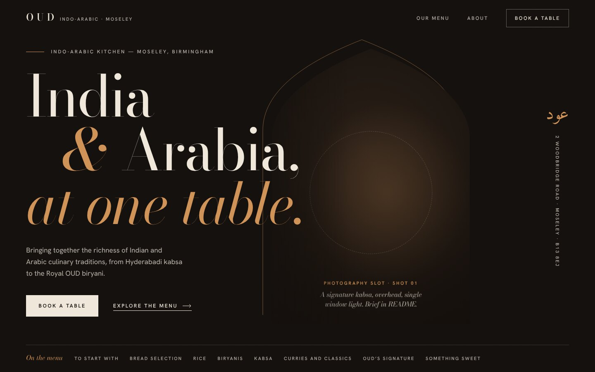
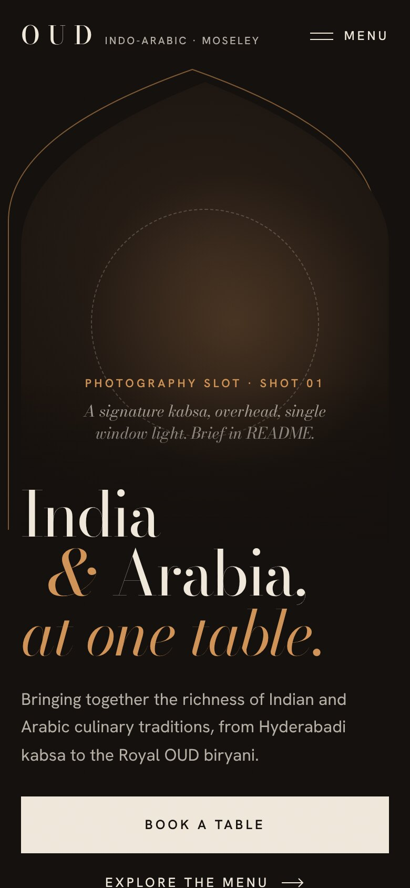

# OUD — Homepage Hero ("The Arch")

A self-contained header + hero for OUD Restaurant (Indo-Arabic, Moseley, Birmingham).
Open `index.html` through any static server (e.g. `npx http-server hero-design-deliverable`)
to see it in isolation.

| Desktop 1440 × 900 | Mobile 390 × 844 |
|---|---|
|  |  |

> **The photograph is not in yet.** The arch currently shows a labelled photography slot,
> not a finished image. See §3. No photography was available in the repository, and this
> build environment could not reach any image library. Nothing has been faked to fill the gap.

---

## 1. Context: what existed

The repository has **no website application yet**: no framework, routes, components, design
tokens, fonts, logo or images. It holds only the Phase 1 research in `docs/research/`.
So the hero is built as framework-neutral HTML + CSS + a small optional JS file. It ports
directly into whatever stack the site uses (see §5).

All copy comes from the research package. Unverified items are flagged in §6.

## 2. Design direction

**One idea: the arch as a window onto the table.**
OUD's About Us describes bringing "together the richness of Indian and Arabic culinary
traditions". The pointed arch belongs to both: the Mughal arches of Hyderabad and Delhi and
the mihrab and doorways of the Arab world. So the photograph sits inside a single tall
pointed arch, as if seen through a doorway. A hairline saffron outline, offset up and left,
reads as its moulding.

- **Composition.** Asymmetric editorial, not "text left, food right". The headline is sized
  so its italic last line, *at one table.*, always crosses into the arch. The arch's position
  is derived from the headline size (`--oud-arch-x`), so the overlap holds from 1024 px to 4K.
  The far right margin carries the name in Arabic (عود, "oud") and the address set vertically,
  like a margin note in a printed menu.
- **Typography.** Bodoni Moda (high-contrast didone, optical size 96) for display: roman for
  *India / Arabia*, italic for the ampersand and the last line. Hanken Grotesk, tracked
  uppercase, for small labels and actions. Amiri for the three Arabic letters only.
- **Palette.** Three values plus one accent: espresso `#14100d`, warm ivory `#efe7da` (and a
  74% tint), and **saffron** `#cf9156`. Saffron colours both kabsa and biryani; it is used
  only for the ampersand, the last line, the moulding and two small labels. No gold
  gradients, glass or glow. A faint film grain keeps the dark field from looking flat.
- **Foot of the hero.** "On the menu" lists the real section names from the current site. It is
  plain text, not links, because most category URLs are unconfirmed.
- **Motion.** Plays once, all in CSS. The arch unveils from the floor while the photo settles
  from 112% scale. The three headline lines rise from masks, 120 ms apart. Supporting text fades
  in after them. On scroll the photograph drifts at most 48 px inside the arch (JS, rAF,
  passive listener). With `prefers-reduced-motion: reduce`, everything renders immediately
  with no drift.
- **Mobile is recomposed, not shrunk.** The page becomes a vertical poster: the arch first
  (with a mobile-specific crown proportion), then the headline overlapping the arch's foot over
  a dark gradient, then full-width "Book a table". Navigation collapses into a "Menu"
  disclosure. Short phones (≤ 760 px tall) tighten the arch so the primary CTA stays in the
  first viewport.

Two directions were considered and rejected. A full-bleed photo with a giant OUD wordmark
depends entirely on photography we don't have, and text-masked imagery is a cliché. A
split-screen layout is exactly the template being avoided.

## 3. Asset requirement: Shot 01 (blocking for launch)

| | |
|---|---|
| Subject | A real OUD signature dish. Recommended: **Lamb Shank Kabsa** or **Hyderabadi Chicken Kabsa** (both on the current menu). Plated exactly as served. |
| Angle | Overhead, or a 70–80° high angle. The plate sits slightly below centre (the dashed circle in the slot shows where). |
| Light | Low-key. One soft window or strip light from frame-right; let the left third fall into shadow so the overlapping headline sits on dark tones. No HDR, no light streaks, no added steam. |
| Surface | Dark: walnut, aged brass or charcoal stone. Copper or brass serveware suits the brand; avoid props scattered for decoration. |
| Format | Portrait **3:4 or taller**. Supply the original at ≥ 2400 px on the short edge. |
| Exports | `assets/hero-shot-01-{800,1200,1600}.{avif,webp,jpg}` (≈ 0.72 aspect, e.g. 1600 × 2222). Target < 220 KB for the 1200 AVIF. |
| Rights | Owner-commissioned, or licensed for web and marketing use. Do not use AI-generated food. |

**To install it** (in `index.html`):

1. Delete the `<div class="oud-hero__pending">…</div>` block.
2. Uncomment the `<picture>` above it. Rewrite the `alt` text to describe the actual photo.
3. Uncomment the `<figcaption>` and name the dish shown.
4. Uncomment the image `<link rel="preload">` in `<head>`.
5. If the plate isn't centred, set the focal point: `style="--oud-focal: 50% 60%"` on the ``.

The slot was tested with a synthetic test card (not shipped): the image fills the arch, crops
correctly at both proportions, the caption and vignettes render, and nothing shifts layout
(the figure's size is fixed by `aspect-ratio`).

## 4. Other assets and open items

- **Logo.** None was available. The wordmark is typographic (Bodoni, tracked caps) and marked
  in the HTML as a stand-in. Swap in the official SVG logo inside `.oud-wordmark`.
- **Arabic name, عود.** A literal rendering of the brand name. The owner should confirm they
  want it shown.

## 5. Files

```
hero-design-deliverable/
├── index.html        Demo page; the hero is between the "copy from here / to here" comments
├── oud-hero.css      All hero styles, tokens, responsive rules and motion (prefixed .oud-)
├── oud-hero.js       Mobile-menu disclosure + parallax (optional; hero works without JS)
├── fonts/            Self-hosted woff2 (Latin subsets; Amiri subset to 3 glyphs, 1.7 KB) + OFL licences
├── assets/           Empty. Place Shot 01 exports here (§3)
└── screenshots/      Rendered at 1920, 1440, 768, 390, plus the open mobile menu
```

**Existing files modified: none.** The only change to the repository is this new folder.

### Integration into the homepage (once the site exists)

- **Plain HTML / server templates:** copy the marked block from `index.html` into the
  homepage template. Link `oud-hero.css` in `<head>`, load `oud-hero.js` with `defer`, and keep
  the `fonts/` paths relative to the CSS.
- **React / Next.js / Vue / Astro:** turn the block into one component. Rename `class` to
  `className` (React). Import the CSS globally or as a module (selectors are already namespaced).
  Run the JS in a mount effect. In Next.js, `next/image` with `priority` can replace
  `<picture>`; keep the `.oud-hero__img` class.
- Keep the `<svg>` with the two `clipPath` definitions in the component. The arch depends on them.
- The rest of the site's navigation should replace or merge with `.oud-nav`. Its links are
  `/` , `#menu`, `/about-us`, `/book-a-table`.
- The homepage needs an element with `id="menu"` for "Explore the menu" and "Our menu", and an
  element with `id="main"` for the skip link.

## 6. Content provenance (must be re-checked before launch)

All of the following came from search-index snippets of oudrestaurant.co.uk, not a live
visit (see `docs/research/`):

| Content | Source | Status |
|---|---|---|
| "Indo-Arabic", Moseley, Birmingham | About Us (indexed) | Unverified |
| "Bringing together the richness of Indian and Arabic culinary traditions" | About Us (indexed) | Paraphrased; unverified |
| Hyderabadi kabsa, Royal OUD biryani | Menu (indexed) | Unverified |
| 2 Woodbridge Road, Moseley, B13 8EJ | About Us / Book a Table (indexed) | Unverified |
| Menu section names | Homepage (indexed) | Unverified |
| `/about-us`, `/book-a-table` routes | Search index | Live status unchecked |

Deliberately left out: ratings, reviews, awards, prices, opening hours (sources conflict) and
halal claims (third-party only).

## 7. QA performed

- Rendered in Chromium (Playwright) at 1920×1080, 1440×900, 1280×720, 1024×768, 768×1024,
  390×844 and 360×740. No horizontal overflow (`scrollWidth === innerWidth` at every size). No
  console errors and no failed requests.
- Mobile menu: opens, closes on link click and Escape, and returns focus to the toggle.
  `aria-expanded` stays in sync.
- Keyboard order: skip link, wordmark, Our menu, About, Book a table, hero CTA, Explore the
  menu. Focus rings are visible (1 px saffron, 4 px offset).
- Reduced motion: the page renders fully composed on first paint.
- Contrast on espresso: ivory ≈ 15:1, 74% ivory ≈ 8.7:1, saffron ≈ 7:1 (WCAG AA/AAA for body text).
- `oud-hero.js` passes `node --check` and ESLint (`no-unused-vars`).
- **Not verified:** real-device Safari/iOS rendering, and the hero with the real photograph.
